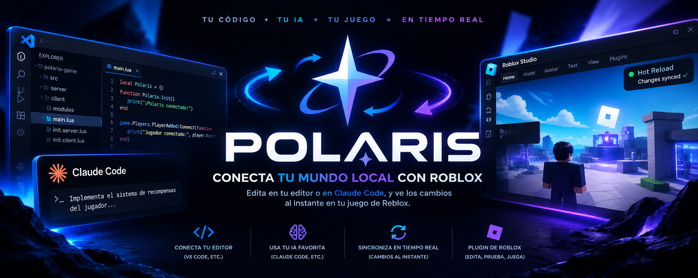

<div align="center">
  

  <p><strong>Roblox Sync Tool</strong></p>

  <p>Two-way sync between your filesystem and Roblox Studio.<br />
  Complete workspace, zero magic.</p>

  <p>
    <a href="LICENSE.md"></a>
    
    
    
  </p>

  <p>
    <a href="#quick-start">Quick start</a> &middot;
    <a href="#commands">Commands</a> &middot;
    <a href="#built-for-tools-and-ai-agents">AI &amp; tooling</a> &middot;
    <a href="#project-layout">Project layout</a> &middot;
    <a href="#roadmap">Roadmap</a>
  </p>
</div>

---

Polaris keeps a Roblox project on disk and a place in Roblox Studio in
sync. Edit files locally and Studio updates. Build inside Studio and clean
files come back to disk. No lock files, no generated blobs, no surprises.

It is the engine of the project: the part that owns the file system, the
DataModel tree and the local server the Studio plugin talks to.

> Polaris is a fork of [Argon](https://github.com/argon-rbx/argon), rebuilt
> around a different goal: a workspace that maps **every** service Roblox
> creates, and a command line that tools and AI agents can drive without
> guessing.

## Why Polaris

| | |
| --- | --- |
| **Complete workspace** | A new project maps all 17 services of a fresh place, so anything you build in Studio is persisted instead of living in memory. |
| **Two-way sync** | Scripts, instances and properties flow both ways with conflict-safe filtering and a debounced writer. |
| **Built for agents** | Every command is non-interactive with `--yes`, and `--json` (or `POLARIS_JSON=1`) prints machine-readable output on stdout while logs stay on stderr. |
| **Multi-project** | Serve several places at the same time; each one gets its own session and port, and `polaris list` shows them all. |
| **No telemetry, no auto-update** | Nothing phones home. No silent downloads from a third-party repository. |
| **Your files, your rules** | Delete a service entry and it is gone. Add one back with `polaris workspace expand`. |

## Install

Windows (PowerShell):

```powershell
powershell -c "irm https://raw.githubusercontent.com/Davissss2/Polaris-Sync/main/install.ps1 | iex"
```

Linux and macOS:

```bash
curl -fsSL https://raw.githubusercontent.com/Davissss2/Polaris-Sync/main/install.sh | sh
```

The installer picks the right binary for your OS and architecture from the
latest release, installs it and, on Windows, adds it to your user `PATH`.
Pin a version with `-Version v0.1.0` (PowerShell) or
`POLARIS_VERSION=v0.1.0` (shell); choose the destination with `-Dir` or
`POLARIS_INSTALL_DIR`. Builds exist for Windows, macOS and Linux on x86_64
and aarch64.

Already have Rust? `cargo install --git https://github.com/Davissss2/Polaris-Sync`
also works.

## Quick start

```bash
# 1. Install the Studio plugin (downloads the matching build)
polaris plugin install

# 2. Scaffold a workspace with every service mapped
polaris init my-game
cd my-game

# 3. Start the local server and open Studio
polaris serve

# 4. Build a place file whenever you need one
polaris build
```

Already have a project that only maps a few services?

```bash
polaris workspace expand
```

## Commands

| Command | What it does |
| --- | --- |
| `polaris init [path]` | Create a project from a template (`game`, `place`, `model`, `plugin`, `package`, `quick`, `empty`) |
| `polaris serve [path]` | Start the local server and watch the file system (`--secure` requires a token) |
| `polaris build [path]` | Build a `.rbxl` / `.rbxlx` (or `.rbxm` / `.rbxmx`) |
| `polaris sourcemap` | Emit a JSON sourcemap of the instance tree |
| `polaris list` | Every session with its project, address, port, PID and status |
| `polaris info` | Services, folders, project type and live session address |
| `polaris workspace expand` | Map every missing service without touching existing folders |
| `polaris exec <code>` | Execute Luau in the connected Studio session |
| `polaris studio` | Launch a new Roblox Studio instance |
| `polaris debug [mode]` | Start or stop a playtest (`play`, `run`, `start`, `stop`) |
| `polaris stop` | Stop one session, or all of them with `--all` |
| `polaris config` | Read, set, export or reset global and workspace settings |
| `polaris plugin` | Install the Studio plugin from the latest release (or a local `.rbxm`) |
| `polaris doc` | Open the project page in your browser |

Global flags: `--yes` (no prompts), `--json` (machine output), `-v/-q`
(verbosity), `-C` (colors), `-B` (backtrace).

## Project layout

A `game` project is a one-to-one mirror of the Roblox DataModel:

```text
my-game/
├── default.project.json
├── src/
│   ├── Workspace/
│   ├── Players/
│   ├── Lighting/
│   ├── MaterialService/
│   ├── ReplicatedFirst/
│   ├── ReplicatedStorage/
│   ├── ServerScriptService/
│   ├── ServerStorage/
│   ├── StarterGui/
│   ├── StarterPack/
│   ├── StarterPlayer/
│   │   ├── StarterCharacterScripts/
│   │   └── StarterPlayerScripts/
│   ├── Teams/
│   ├── SoundService/
│   ├── TextChatService/
│   ├── LocalizationService/
│   └── TestService/
└── Packages/            # Wally, when enabled
```

Anything you drop in `src/Workspace` shows up in Studio, and anything you
build in Studio lands back in `src/Workspace`. Removing a service is
deleting its entry from `default.project.json` and its folder.

### Supported formats

| Kind | Files |
| --- | --- |
| Scripts | `.luau`, `.lua`, `.server.luau`, `.client.luau` and their `init` variants |
| Instances | `*.model.json`, `*.meta.json`, `*.data.json` |
| Roblox models | `.rbxm`, `.rbxmx` |
| Data | `.json`, `.toml`, `.yaml`, `.csv`, `.txt`, `.md`, `.msgpack` |

> Meshes are a special case: Roblox stores geometry in the cloud, so a
> `MeshPart` only carries a `MeshId`. A `.rbxm` model with a valid
> `MeshId` syncs as-is; importing raw `.fbx` files automatically is on the
> roadmap through the official Open Cloud assets API.

## Built for tools and AI agents

Every command speaks JSON when you ask for it. Output goes to stdout,
logs go to stderr, exit codes are meaningful.

```bash
polaris init ./demo --json
```

```json
{
  "name": "demo",
  "project": "./demo/default.project.json",
  "workspace": "./demo",
  "template": "game"
}
```

```bash
polaris list --json
```

```json
[
  {
    "id": "0",
    "project": "/home/me/games/a/default.project.json",
    "address": "http://localhost:8000",
    "pid": 4084,
    "running": true
  }
]
```

```bash
polaris info --json     # services, folders, type, session address
polaris exec 'print(game.Workspace)'
```

Agents do not need any extra server. Load the bundled skill and let it drive
the CLI:

- [skills/polaris/SKILL.md](skills/polaris/SKILL.md) — task oriented playbook
  (discover sessions, create instances, edit properties, verify a sync)
- [AGENTS.md](AGENTS.md) — how to work on this repository itself

Drop the skill folder into your agent's skills directory (for example
`.claude/skills/polaris`) and it will know when and how to call Polaris.

## Security

The server only listens on `localhost`, but by default any local process can
talk to it. Start it with `--secure` to require a session token:

```bash
polaris serve --secure      # prints the token, also stored in ~/.polaris/token
```

Paste that token once in the plugin settings (`Session Token`). The CLI reads
it from disk on its own, so `polaris exec`, `polaris list` and `polaris stop`
keep working without extra flags. Without a token the server prints a warning
on startup.

## Configuration

Settings live in `polaris.toml` (workspace) or `<data dir>/config.toml`
(global). Legacy `argon.toml` files are still read, and the legacy data
directory is migrated automatically.

```bash
polaris config --list
polaris config port 8000
polaris config --default        # back to defaults
polaris config --export my.toml
```

## Roadmap

- [x] Polaris Studio plugin (fork of the Argon plugin, session auth, restricted `exec`)
- [ ] `polaris import <place.rbxl>` to scaffold a project from an existing place
- [ ] `polaris asset` for mesh uploads through Roblox Open Cloud
- [ ] Local dashboard: sessions, instance tree, inspector, live logs
- [ ] Optional MCP server for agents that prefer tools over a CLI

## Development

```bash
cargo build
cargo test
./target/debug/polaris --help
```

Templates are bundled into the binary from `assets/templates`, so no
build step is needed after editing them.

## License and attribution

Apache-2.0. Polaris is an independent fork of
[Argon](https://github.com/argon-rbx/argon), also Apache-2.0. The original
license text is preserved in [LICENSE.md](LICENSE.md) and attribution
lives in [NOTICE](NOTICE). "Argon", its logo and its assets belong to
their respective owners and are not part of this distribution.
